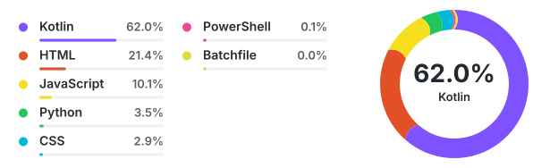
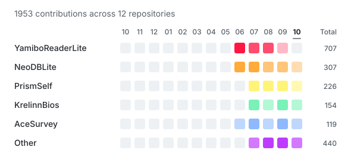

## 📦 Projects

- [Which Me](https://whichme.xyz) — 面向中英文用户的结构化自我探索测评网站
- [Outvalue](https://outvalue.lol/) — 面向独立开发者的免费工具箱与限时付费作品展示站点
- [PrismSelf](https://github.com/KrelinnBios/PrismSelf) — 面向性别理论、心理概念与人际关系议题的中文知识库
- [NeoDBLite](https://github.com/KrelinnBios/NeoDBLite) — 面向 NeoDB 与兼容实例的非官方 Android 标记客户端
- [YamiboPlus](https://github.com/KrelinnBios/YamiboPlus) — 面向百合会论坛的非官方原生 Android 客户端
- [Bgm2NeoDB](https://github.com/KrelinnBios/Bgm2NeoDB) — 将 Bangumi 收藏迁移到 NeoDB 的本地网页工具

## 💻 Languages

  

## 📊 Contribution Focus

  

